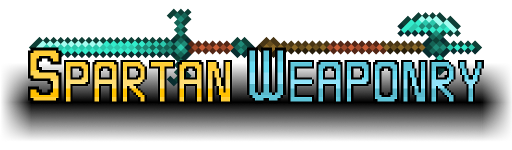
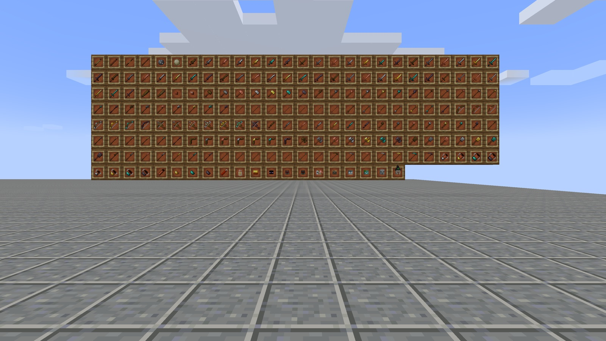
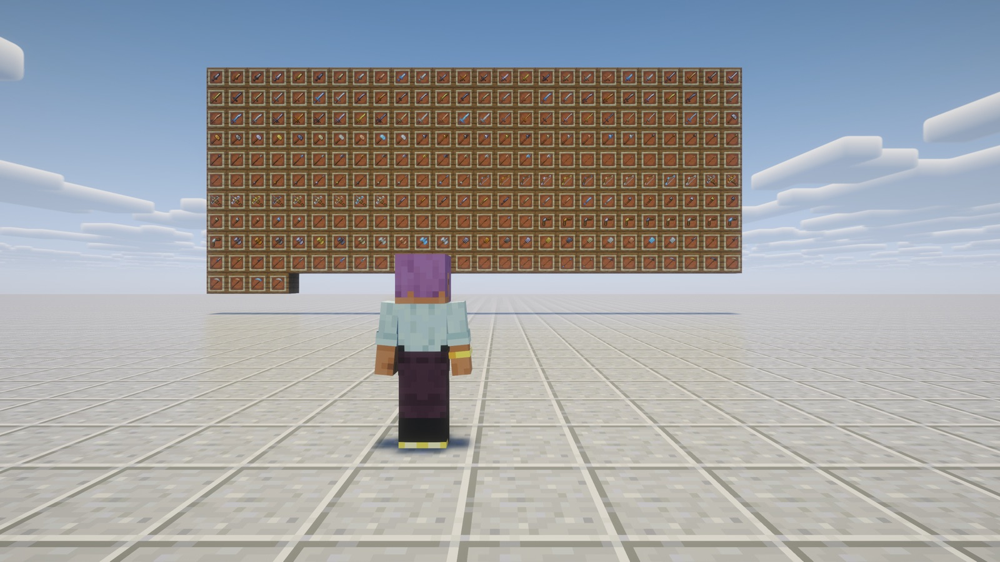
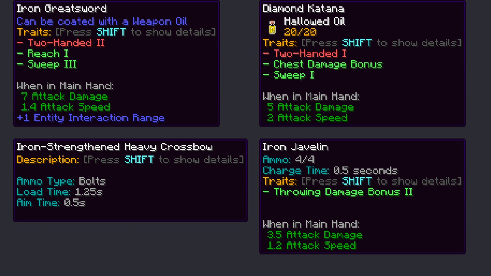
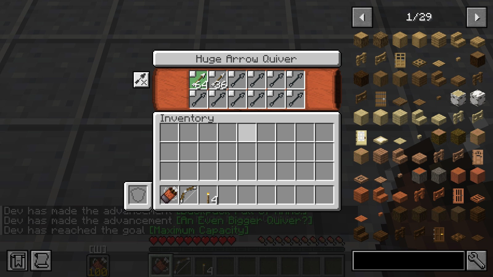
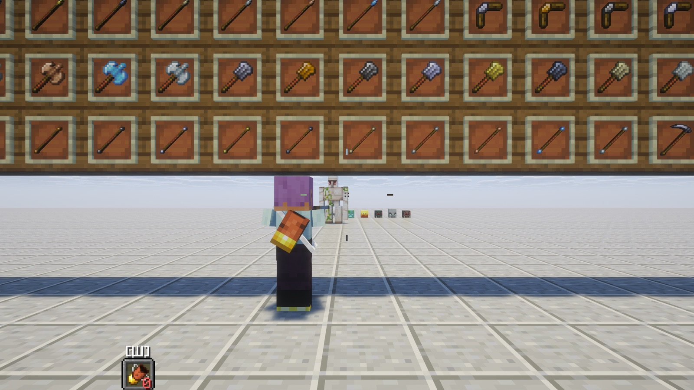
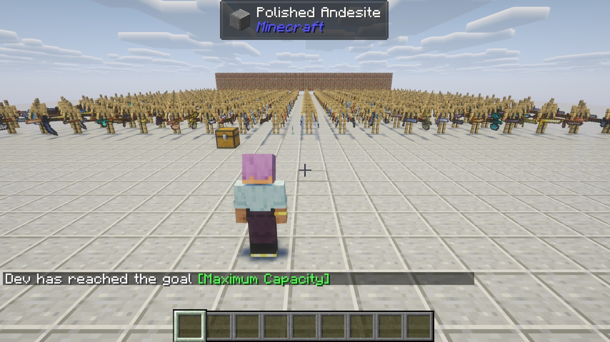

# Spartan Weaponry — NeoForge & Fabric 1.21.1

**Weapons galore!**

An unofficial port of **[Spartan Weaponry](https://www.curseforge.com/minecraft/mc-mods/spartan-weaponry)** 3.2.1
by **ObliviousSpartan** from Minecraft 1.20.1 (Forge) to **NeoForge and Fabric 1.21.1**, with all of its content.

---

## ⚔️ About the mod

Spartan Weaponry adds a whole new arsenal to Minecraft, inspired by Balkon's WeaponMod: swords, polearms, blunt,
thrown and ranged weapons, each with its own traits.

- **26 weapon types, 436 weapons**: daggers, parrying daggers, longswords, katanas, sabers, rapiers, greatswords, clubs,
  cestus, battle hammers, warhammers, spears, halberds, pikes, lances, battleaxes, flanged maces, glaives,
  quarterstaves, scythes, throwing knives, tomahawks, javelins, boomerangs, longbows and heavy crossbows — in wood,
  stone, leather, copper, iron, gold, diamond and netherite, plus the metals of other mods (tin, bronze, steel, silver,
  electrum, lead, nickel, invar, constantan, platinum, aluminium)
- **Weapon traits**: reach, sweep, armour piercing, two-handed, quick strike, decapitate, block, hammer slam,
  versatile (mines like a tool) and more — shown in the tooltip, set by data packs
- **Thrown weapons** with ammo stacks, **boomerangs** that come back, **longbows** and **heavy crossbows** with their
  own crosshairs and arrows / bolts of copper, iron, diamond and netherite, tipped with any potion, plus explosive arrows
  and dynamite
- **Quivers** in four sizes (in a Curios back slot too): arrows and bolts move to your off hand when you pick up a bow
- **Weapon oils** brewed in a brewing stand: bonus damage against undead, arthropods, creepers, ... or a potion effect
  on every hit
- **Nine enchantments** for thrown weapons, boomerangs and heavy crossbows, **heads** of eleven more mobs, mobs that
  spawn with the new weapons, loot in village and End city chests
- **Configurable**: damage, speed and durability of every weapon type and material, disable any type or material
- **Languages**: English, Russian, Ukrainian, German, Spanish, Brazilian Portuguese, Chinese, Mexican Spanish, French
  (Ukrainian and German and the completed parts of the others are machine translations, corrections welcome)

## 📸 Screenshots

  
  
  
  
  
  

## 📦 Installation

**NeoForge**

1. Install **NeoForge 21.1.197** or newer for Minecraft **1.21.1**.
2. Put `spartanweaponry-neoforge-3.2.1.2+1.21.1.jar` from the [releases](../../releases) into `mods`.

No other mods needed. Optional: **Curios** (quiver in the back slot), **JEI** / **EMI** (tipped projectile and oil
recipes), **Shoulder Surfing** 4.x / 5.x (aims like a bow), **JEED**.

**Fabric**

1. Install **Fabric Loader 0.16.14** or newer for Minecraft **1.21.1**.
2. Put into `mods`: `spartanweaponry-fabric-3.2.1.2+1.21.1.jar` from the [releases](../../releases),
   **[Fabric API](https://modrinth.com/mod/fabric-api)** and
   **[Forge Config API Port](https://modrinth.com/mod/forge-config-api-port)** 21.1.6 or newer (the settings).

Optional: **JEI** (tipped projectile and oil recipes), **EMI**, **Shoulder Surfing** 4.x / 5.x, **JEED**. On Fabric the quiver has no back slot (that is Curios, which is NeoForge only); it works from the hotbar.

Both: required on the client and the server. Settings: `config/spartanweaponry-common.toml`,
`config/spartanweaponry-client.toml`. Worlds of the 1.20.1 version open with their weapons, oils, quivers and loaded
crossbows.

## 🔧 What changed in the port

Content, recipes and numbers are those of 3.2.1. Bugs of the original that the port fixes:

| Original issue | Fix |
| --- | --- |
| [#170](https://github.com/ObliviousSpartan/SpartanWeaponry/issues/170), [#203](https://github.com/ObliviousSpartan/SpartanWeaponry/issues/203), [#201](https://github.com/ObliviousSpartan/SpartanWeaponry/issues/201), [#196](https://github.com/ObliviousSpartan/SpartanWeaponry/issues/196), [#178](https://github.com/ObliviousSpartan/SpartanWeaponry/issues/178), [#160](https://github.com/ObliviousSpartan/SpartanWeaponry/issues/160), [#148](https://github.com/ObliviousSpartan/SpartanWeaponry/issues/148) Crashes with C2ME / threaded world generation | Mobs spawned in structures pick their weapon with their own random, not the server thread's |
| [#186](https://github.com/ObliviousSpartan/SpartanWeaponry/issues/186) Thrown weapons deal huge damage (thrown from above) | A throw damages each mob once; boomerangs may hit again after they turn back |
| [#183](https://github.com/ObliviousSpartan/SpartanWeaponry/issues/183) Thrown weapons ignore the config · [#167](https://github.com/ObliviousSpartan/SpartanWeaponry/issues/167) Longbow durability ignores the config | Both follow the config |
| [#169](https://github.com/ObliviousSpartan/SpartanWeaponry/issues/169) Two-handed weapons remove Mining Fatigue | Only their own Mining Fatigue runs out |
| [#165](https://github.com/ObliviousSpartan/SpartanWeaponry/issues/165) Heavy crossbow bolts turn black after rejoining | Bolts and thrown weapons are saved with their item (they were lost on reload) |
| [#149](https://github.com/ObliviousSpartan/SpartanWeaponry/issues/149) Constantan uses the Invar stats | Constantan has its own traits |
| [#168](https://github.com/ObliviousSpartan/SpartanWeaponry/issues/168) Dropped battleaxes are huge | Same size as a dropped sword |
| [#172](https://github.com/ObliviousSpartan/SpartanWeaponry/issues/172) Enchantments have no supported items | Enchantments are data with item tags (other mods see where they apply) |
| [#185](https://github.com/ObliviousSpartan/SpartanWeaponry/issues/185) Skeletons don't shoot longbows · [#188](https://github.com/ObliviousSpartan/SpartanWeaponry/issues/188) Arrows duplicate · [#193](https://github.com/ObliviousSpartan/SpartanWeaponry/issues/193) Quiver screen broken · [#192](https://github.com/ObliviousSpartan/SpartanWeaponry/issues/192) Crash with Shoulder Surfing | Not reproducible in the port (tested) |

Found while porting:

- Opening a quiver could disconnect the player (the screen arrived before the client had the quiver); a quiver with no
  ammo still moved the off-hand item away; the quiver priority slot packet took any index.
- Copper arrows called lightning in any weather when tipped; the oil commands never suggested oils; villager trades
  could crash; the weaponsmith's weapon trades offered from an empty list (crash when a villager got one); the quiver HUD and the throwing crosshair drew textures that no longer exist; Russian, Spanish and
  Portuguese tooltips with broken numbers.

The full list, with the reasons and what 1.21 changed, is in **[PORTLOG.md](PORTLOG.md)**.

## ✅ Tested

- **Functional** (54 checks, in English and Russian): longbow, heavy crossbow and javelin with real input, oils, traits (reach, armour piercing,
  two-handed, block, decapitate), Lucky Throw, quivers, enchanting table, recipes, loot, mobs with longbows, saving and
  rejoining, 1.20.1 items, data packs; dedicated servers NeoForge 21.1.197 and 21.1.259.
- **Stress**: 600 quiver packets with bad values, 400 armor stands with 800 weapons on screen, 110 fighting mobs
  (server tick 2 ms), 600 projectiles at once.
- **Compatibility**: Sodium 0.6 + Iris 1.8 with Complementary shaders, Lithium, FerriteCore, ModernFix, JEI, EMI, Jade,
  Curios, JEED, Shoulder Surfing 4.5 and 5.2.
- **Fabric** (Loader 0.16.14, Fabric API 0.116.17, Forge Config API Port 21.1.6): the same scene (56 checks; Curios
  ones are NeoForge only), the release jar on a dedicated Fabric server and the scenes on a production client;
  compatibility with Sodium 0.6.13 + Iris 1.8.8 with Complementary shaders, Lithium, FerriteCore, ModernFix, Jade, EMI,
  JEED and Shoulder Surfing 4.5.

## ❤️ Credits

- **Spartan Weaponry** — made by **ObliviousSpartan** ·
  [CurseForge](https://www.curseforge.com/minecraft/mc-mods/spartan-weaponry) ·
  [Modrinth](https://modrinth.com/mod/spartan-weaponry) ·
  [source](https://github.com/ObliviousSpartan/SpartanWeaponry). All the content, art and ideas are theirs.
  Translations of the original by its contributors.
- **Port** to NeoForge and Fabric 1.21.1 — [Vladeezyy](https://github.com/Vladeezyy).
- Bugs of **this port**: [issues](../../issues). Please don't report port bugs to the original author.

### License

The port is licensed under the **GNU LGPL 3.0 only** ([LICENSE](LICENSE), with the GPL 3.0 it refers to in
[licenses/COPYING](licenses/COPYING)). Copyright (c) 2026 Vladeezyy for the port.
The original Spartan Weaponry is © ObliviousSpartan under the **Apache License 2.0**, kept in
[licenses/LICENSE-APACHE](licenses/LICENSE-APACHE); its code and art stay under that license.
Forks are welcome: they must stay open, under the same license, and credit the authors.
Please download the mod only from the official pages.

---

<b>🇷🇺 Описание на русском</b>

 

**Оружия — завались!**

Неофициальный порт мода **[Spartan Weaponry](https://www.curseforge.com/minecraft/mc-mods/spartan-weaponry)** 3.2.1
от **ObliviousSpartan** с Minecraft 1.20.1 на **NeoForge 1.21.1** — со всем содержимым.

<b>⚔️ О моде</b>

Spartan Weaponry добавляет в Minecraft целый новый арсенал по мотивам WeaponMod от Balkon: мечи, древковое, дробящее,
метательное и стрелковое оружие, у каждого — свои особенности.

- **26 видов оружия, 436 предметов**: кинжалы, парирующие кинжалы, полуторные мечи, катаны, сабли, рапиры, двуручные
  мечи, дубинки, цестусы, боевые молоты, клевцы, копья, алебарды, пики, турнирные копья, боевые топоры, перначи,
  глефы, боевые посохи, косы, метательные ножи, томагавки, метательные копья, бумеранги, большие луки и тяжёлые
  арбалеты — из дерева, камня, кожи, меди, железа, золота, алмаза и незерита, а также из металлов других модов
  (олово, бронза, сталь, серебро, электрум, свинец, никель, инвар, константан, платина, алюминий)
- **Особенности оружия**: досягаемость, размах, бронебойность, двуручность, быстрый удар, обезглавливание, блок, удар
  молотом, универсальность (добывает блоки как инструмент) и другие — видны в подсказке, настраиваются датапаками
- **Метательное оружие** со стопками снарядов, **бумеранги**, которые возвращаются, **большие луки** и **тяжёлые
  арбалеты** со своими прицелами, стрелы и болты из меди, железа, алмаза и незерита, с любым зельем, взрывные стрелы и
  динамит
- **Колчаны** четырёх размеров (и в слоте Curios на спине): стрелы и болты сами переходят в левую руку, когда берёшь лук
- **Оружейные масла** из варочной стойки: бонус к урону по нежити, членистоногим, криперам… или эффект зелья при каждом
  ударе
- **Девять зачарований** для метательного оружия, бумерангов и тяжёлых арбалетов, **головы** ещё одиннадцати мобов,
  мобы с новым оружием, добыча в сундуках деревень и городов Энда
- **Настройки**: урон, скорость и прочность каждого вида и материала, отключение любого вида или материала
- **Языки**: английский, русский, украинский, немецкий, испанский, бразильский португальский, китайский, мексиканский
  испанский, французский (украинский, немецкий и дополненные части остальных — машинный перевод, правки приветствуются)

<b>📦 Установка</b>

**NeoForge**

1. Установите **NeoForge 21.1.197** или новее для Minecraft **1.21.1**.
2. Положите `spartanweaponry-neoforge-3.2.1.2+1.21.1.jar` из [релизов](../../releases) в папку `mods`.

Других модов не нужно. По желанию: **Curios** (колчан на спине), **JEI** / **EMI** (рецепты наконечников и масел),
**Shoulder Surfing** 4.x / 5.x (прицеливание как с луком), **JEED**.

**Fabric**

1. Установите **Fabric Loader 0.16.14** или новее для Minecraft **1.21.1**.
2. Положите в `mods`: `spartanweaponry-fabric-3.2.1.2+1.21.1.jar` из [релизов](../../releases),
   **[Fabric API](https://modrinth.com/mod/fabric-api)** и
   **[Forge Config API Port](https://modrinth.com/mod/forge-config-api-port)** 21.1.6 или новее (настройки).

По желанию: **JEI** (рецепты наконечников и масел), **EMI**, **Shoulder Surfing** 4.x / 5.x, **JEED**. На Fabric у колчана нет слота на спине (это Curios, он есть только на NeoForge); колчан работает из хотбара.

Для обоих: нужен и на клиенте, и на сервере. Настройки: `config/spartanweaponry-common.toml`,
`config/spartanweaponry-client.toml`. Миры версии для 1.20.1 открываются со всем оружием, маслами, колчанами и
заряженными арбалетами.

<b>🔧 Что изменилось в порте</b>

Содержимое, рецепты и числа — как в 3.2.1. Исправлены баги оригинала:

- **Краши с C2ME / многопоточной генерацией мира** ([#170](https://github.com/ObliviousSpartan/SpartanWeaponry/issues/170),
  [#203](https://github.com/ObliviousSpartan/SpartanWeaponry/issues/203), [#201](https://github.com/ObliviousSpartan/SpartanWeaponry/issues/201),
  [#196](https://github.com/ObliviousSpartan/SpartanWeaponry/issues/196), [#178](https://github.com/ObliviousSpartan/SpartanWeaponry/issues/178),
  [#160](https://github.com/ObliviousSpartan/SpartanWeaponry/issues/160), [#148](https://github.com/ObliviousSpartan/SpartanWeaponry/issues/148)) —
  мобы в структурах выбирают оружие своим генератором случайных чисел, а не генератором серверного потока.
- **Огромный урон метательного оружия** ([#186](https://github.com/ObliviousSpartan/SpartanWeaponry/issues/186)) — один
  бросок ранит моба один раз; бумеранг может ударить снова после разворота.
- **Метательное оружие и большие луки игнорировали конфиг** ([#183](https://github.com/ObliviousSpartan/SpartanWeaponry/issues/183),
  [#167](https://github.com/ObliviousSpartan/SpartanWeaponry/issues/167)) — теперь следуют ему.
- **Двуручное оружие снимало «Утомление»** ([#169](https://github.com/ObliviousSpartan/SpartanWeaponry/issues/169)) —
  заканчивается только своё.
- **Болты чернели после перезахода** ([#165](https://github.com/ObliviousSpartan/SpartanWeaponry/issues/165)) — болты и
  брошенное оружие сохраняются вместе с предметом (раньше пропадали при перезагрузке).
- **Константан со статами инвара** ([#149](https://github.com/ObliviousSpartan/SpartanWeaponry/issues/149)),
  **огромные выброшенные секиры** ([#168](https://github.com/ObliviousSpartan/SpartanWeaponry/issues/168)),
  **зачарования без списка предметов** ([#172](https://github.com/ObliviousSpartan/SpartanWeaponry/issues/172)).
- Не воспроизводятся в порте (проверено): скелеты с большими луками
  ([#185](https://github.com/ObliviousSpartan/SpartanWeaponry/issues/185)), дюп стрел
  ([#188](https://github.com/ObliviousSpartan/SpartanWeaponry/issues/188)), экран колчана
  ([#193](https://github.com/ObliviousSpartan/SpartanWeaponry/issues/193)), краш с Shoulder Surfing
  ([#192](https://github.com/ObliviousSpartan/SpartanWeaponry/issues/192)).

Найдено при портировании: открытие колчана могло выкинуть игрока с сервера; пустой колчан всё равно убирал предмет из
левой руки; пакет приоритетного слота принимал любой номер; медные стрелы с зельем вызывали молнию в любую погоду;
команды масел не подсказывали масла; торговля с жителями могла уронить игру; сделки оружейника брали оружие из пустого списка (краш, когда житель получал такую сделку); HUD колчана и прицел метательного оружия
рисовали несуществующие текстуры; сломанные числа в русских, испанских и португальских подсказках.

Полный список с причинами — в **[PORTLOG.md](PORTLOG.md)** (на английском).

<b>✅ Проверено</b>

- **Функционально** (54 проверки, на английском и русском): большой лук, тяжёлый арбалет и метательное копьё с настоящим вводом, масла,
  особенности (досягаемость, бронебойность, двуручность, блок, обезглавливание), «Удачный бросок», колчаны, стол
  зачарований, рецепты, добыча, мобы с большими луками, сохранение и перезаход, предметы из 1.20.1, датапаки;
  выделенные серверы NeoForge 21.1.197 и 21.1.259.
- **Нагрузка**: 600 пакетов колчана с мусорными значениями, 400 стоек с 800 предметами оружия на экране, бой 110 мобов
  (тик сервера 2 мс), 600 снарядов одновременно.
- **Совместимость**: Sodium 0.6 + Iris 1.8 с шейдерами Complementary, Lithium, FerriteCore, ModernFix, JEI, EMI, Jade,
  Curios, JEED, Shoulder Surfing 4.5 и 5.2.
- **Fabric** (Loader 0.16.14, Fabric API 0.116.17, Forge Config API Port 21.1.6): та же сцена (56 проверок; проверки
  Curios — только на NeoForge), release jar на выделенном сервере Fabric и сцены на production-клиенте; совместимость
  с Sodium 0.6.13 + Iris 1.8.8 с шейдерами Complementary, Lithium, FerriteCore, ModernFix, Jade, EMI, JEED и Shoulder
  Surfing 4.5.

<b>❤️ Авторы и лицензия</b>

- **Spartan Weaponry** — автор **ObliviousSpartan** ·
  [CurseForge](https://www.curseforge.com/minecraft/mc-mods/spartan-weaponry) ·
  [Modrinth](https://modrinth.com/mod/spartan-weaponry) ·
  [исходники](https://github.com/ObliviousSpartan/SpartanWeaponry). Всё содержимое, графика и идеи — его.
  Переводы оригинала — его участников.
- **Порт** на NeoForge и Fabric 1.21.1 — [Vladeezyy](https://github.com/Vladeezyy).
- О багах **порта** пишите в [issues](../../issues), а не автору оригинала.

Порт распространяется под **GNU LGPL 3.0 only** ([LICENSE](LICENSE), GPL 3.0 — в [licenses/COPYING](licenses/COPYING)).
Оригинальный Spartan Weaponry © ObliviousSpartan под **Apache License 2.0**
([licenses/LICENSE-APACHE](licenses/LICENSE-APACHE)); его код и графика остаются под ней.
Форки приветствуются: они должны оставаться открытыми, под той же лицензией и с указанием авторов.
Скачивайте мод только с официальных страниц.

